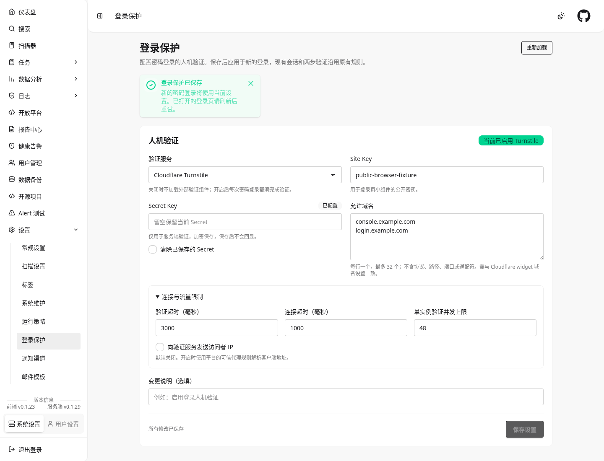

# 登录人机验证

[文档中心](README.md) · [服务端部署与配置](https://github.com/wshijiang/network-mapping/blob/main/docs/HUMAN_VERIFICATION.md)

登录页支持可选 Cloudflare Turnstile 小组件，开关、公开 site key 及受保护动作均来自服务端，无需设置前端环境变量。默认关闭时不加载厂商脚本或 iframe。

## 配套部署

先部署支持 `GET /api/auth/human-verification` 和 `GET/PUT /api/config/human-verification` 的服务端，再部署本前端。随后管理员在“设置 → 登录保护”配置验证服务、Site Key、Secret Key 和实际域名。保存后新的登录使用当前设置，无需重启或重新构建；已打开的登录页需刷新。文件/env 仅作为数据库缺失记录时的初始化种子，不能覆盖 Web 保存的策略。

新前端不会把旧服务端的 404、网络错误或未知配置视为关闭。如果配置加载失败，检查后端和代理版本并使用页面重试按钮；回退到旧服务端之前先恢复兼容前端。Docker 集成还须更新服务端的固定 `.github/frontend-ref`，见[镜像集成](DOCKER.md)。

浏览器需能访问 `https://challenges.cloudflare.com`。服务端会在开启时允许相应脚本和 iframe 的 CSP；上游代理自定义 CSP 也须同步配置。不要反代或自托管 `api.js`。

## 登录行为

启用时，组件完成验证后才允许点击登录或按 Enter 提交。证明随原有登录 JSON 的 `human_verification.token` 发送给后端。每次密码尝试之后均重新验证；过期、超时或错误会清除旧证明，错误状态提供“重新验证”。证明只保存在内存中。

密码验证成功并要求 TOTP 时，仍按原有流程切换到验证码卡片。该阶段不重复使用证明；返回密码卡片会重新创建组件。会话过期弹窗继续跳转统一登录页。明暗主题切换会重新渲染组件并作废旧证明。

## 管理界面

管理员菜单和设置首页均提供“登录保护”入口（`/setting/human-verification`）。页面可切换关闭/Cloudflare Turnstile，管理域名，并展开连接超时、验证预算、并发上限及发送访问者 IP 设置。表单在必填项和范围校验通过后才能保存，未保存离开时提示确认。

允许域名包含其本身和所有层级子域名，与 Cloudflare 一致：填写 `console.example.com` 后可用于 `a.console.example.com`，不包含父域 `example.com` 或兄弟域 `other.example.com`。填写普通 DNS 名，无需也不接受 `*`；要缩小范围请填写具体登录域。服务端仍校验厂商返回的 hostname 和 action。

Secret 输入只用于新建或替换，后端加密保存，读取时只显示“已配置/未配置”。留空保留已有值，停用后可显式勾选清除；成功保存和离开页面时清空输入。不要在变更说明中填写密钥。读取失败时不能用默认值覆盖服务端配置；并发保存冲突返回 409，页面保留输入，必须重新加载再编辑。页面及写入接口仅限管理员，写入沿用 CSRF 保护。

服务端对每个新的登录请求读取数据库权威版本；读取失败时拒绝登录，不自动关闭保护。多实例需共享数据库及相同的 `server.encrypt_key`。主密钥备份、API 请求格式和恢复步骤见[服务端说明](https://github.com/wshijiang/network-mapping/blob/main/docs/HUMAN_VERIFICATION.md)。

[窄屏深色主题预览](images/human-verification-settings-mobile.png)。截图使用测试数据，不包含真实密钥。

## 维护与验证

- `src/components/HumanVerificationWidget.vue`：统一组件、状态与生命周期；暴露 reset。
- `src/utils/humanVerification.js`：严格解析公开配置、生成登录证明、选择服务商适配器。
- `src/utils/humanVerification/turnstile.js`：单例脚本加载、render/reset/remove、过期和错误回调。
- `src/Login.vue`：读取公开配置、提交证明、保留密码/TOTP 登录交互。
- `src/views/HumanVerificationSettings.vue`：管理员表单、并发冲突、加载失败与未保存修改保护。
- `src/utils/humanVerificationSettings.js`：管理 DTO、输入校验和写入载荷，禁止读取或回填 Secret。

后续服务商通过统一适配器契约扩展；服务商网络和 token 规则留在适配器内，页面不直接调用 SDK。未知 provider/schema 会显示错误，不能静默跳过。

运行 `pnpm test:human-verification`、`node --test src/utils/*.test.js` 和 `pnpm build`。交互验收至少覆盖：默认关闭无外联、启用后的成功/失败/过期、脚本失败后重试、重复点击/Enter、明暗主题、窄屏、TOTP 返回，以及组件在脚本加载期间卸载。管理页还应覆盖开启、留空保留 Secret、停用并清除、版本冲突、权限与加载失败、未保存修改和窄屏布局。自动化联调使用官方测试 key 或本地 SDK/API mock，不使用真实生产密钥。
